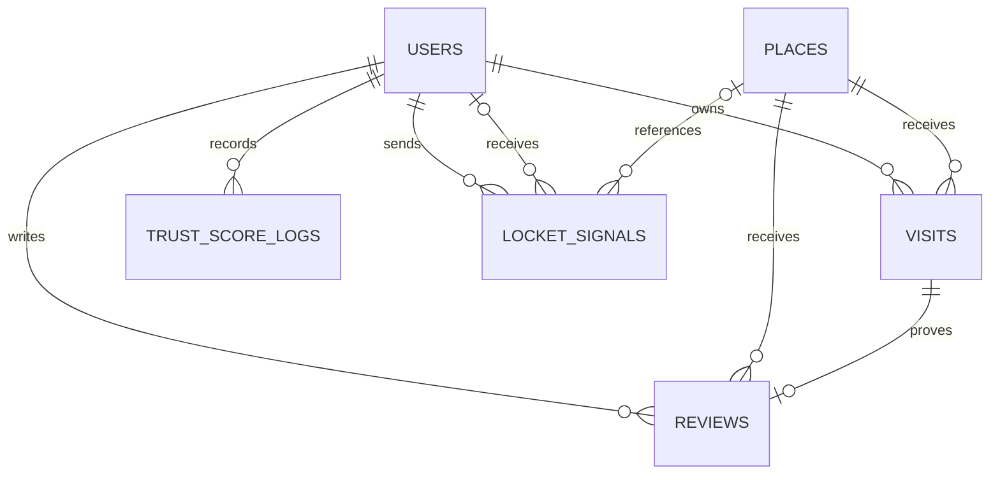

# Thiết kế dữ liệu

## 1. Nguồn dữ liệu và trách nhiệm lưu trữ

| Nơi lưu | Dữ liệu thực tế | Nguồn code |
|---|---|---|
| PostgreSQL | User, place, visit, review, Locket signal, trust log | BE `doc/03_create_schema.sql`, các entity |
| Thư mục upload backend | Nội dung file ảnh; DB chỉ lưu URL | `MediaStorageServiceImpl`, `TTN_UPLOAD_DIR` |
| Secure storage mobile | JWT với key `ttn_access_token` | FE `lib/services/token_storage.dart` |
| RAM mobile | AuthState, user profile, token gắn Dio, trạng thái form | AuthController, ApiService, AuthScreen |
| SQLite local | **Chưa triển khai** | Có dependency `sqflite` nhưng chưa có openDatabase/schema/DAO/cache |

Không lưu mật khẩu gốc ở DB hoặc mobile. Backend có `password_hash` PBKDF2; response profile không có trường này. JWT được lưu an toàn ở thiết bị, không dùng SQLite/SharedPreferences trong luồng hiện tại.

## 2. Quan hệ

User có nhiều visit/review/log/signal. Mỗi visit tối đa một review qua unique `visit_id`; mỗi cặp user/place tối đa một review qua unique composite. `receiver_id` và `place_id` của signal nullable; request hiện chưa sử dụng receiver cụ thể.

## 3. Từ điển bảng

N = NOT NULL. Các cột không đánh N có thể null theo schema SQL. Khóa chính tất cả bảng là UUID; default SQL `gen_random_uuid()`, entity cũng dùng GenerationType.UUID. Thời gian dùng `TIMESTAMP WITHOUT TIME ZONE`.

### users

| Cột | Kiểu | Ràng buộc / nghĩa |
|---|---|---|
| id | UUID | PK |
| email | VARCHAR(150) | N, unique; thêm unique index `lower(email)` |
| full_name | VARCHAR(150) | N, tên hiển thị |
| avatar_url | TEXT | URL ảnh đại diện |
| bio | VARCHAR(500) | Tiểu sử |
| trust_score | INTEGER | N, default 50; cập nhật theo nghiệp vụ |
| password_hash | VARCHAR(255) | Hash PBKDF2; null với Google-only/seed |
| fcm_token | TEXT | Token thiết bị; chưa có gửi push |
| created_at | TIMESTAMP | N, default CURRENT_TIMESTAMP |

### places

| Cột | Kiểu | Ràng buộc / nghĩa |
|---|---|---|
| id | UUID | PK |
| name | VARCHAR(200) | N |
| category | VARCHAR(50) | N; ví dụ CAMPUS/HERITAGE/NATURE |
| description | TEXT | Mô tả |
| address | VARCHAR(300) | N |
| image_url | TEXT | Ảnh đại diện |
| opening_hours | VARCHAR(100) | Giờ mở cửa dạng chuỗi |
| latitude / longitude | DOUBLE PRECISION | N, tọa độ chuẩn |
| allowed_radius_m | DOUBLE PRECISION | N, default 200; bán kính riêng từng nơi |
| average_rating | DOUBLE PRECISION | N, default 0; tổng hợp review verified |
| verified_review_count | INTEGER | N, default 0 |
| is_hidden | BOOLEAN | N, default FALSE; không hiện trong search/detail |

Index `idx_places_category(category)`. Search dùng ILIKE tên/địa chỉ; index category không tự tối ưu mọi tìm kiếm `%keyword%`.

### visits

| Cột | Kiểu | Ràng buộc / nghĩa |
|---|---|---|
| id | UUID | PK |
| user_id | UUID | N, FK users, ON DELETE CASCADE |
| place_id | UUID | N, FK places, ON DELETE CASCADE |
| check_in_time | TIMESTAMP | N, server tạo |
| check_out_time | TIMESTAMP | Null khi OPEN |
| user_lat / user_lng | DOUBLE PRECISION | N, vị trí check-in client gửi |
| gps_accuracy | DOUBLE PRECISION | Độ chính xác thiết bị báo, đơn vị m |
| distance_meters | DOUBLE PRECISION | N, Haversine server tính |
| is_mocked | BOOLEAN | N, default FALSE |
| status | VARCHAR(30) | N, CHECK OPEN/VERIFIED/REJECTED |
| rejection_reason | VARCHAR(300) | Lý do nếu có |

Index `idx_visits_user_status(user_id,status)`. “Tối đa 1 OPEN/user” hiện được thực hiện bằng lock user + kiểm tra repository, **chưa có partial unique index** trong SQL. Chặn GPS trả lỗi trước save, nên enum REJECTED không có nghĩa API hiện lưu mọi lần thất bại.

### reviews

| Cột | Kiểu | Ràng buộc / nghĩa |
|---|---|---|
| id | UUID | PK |
| user_id | UUID | N, FK users, ON DELETE CASCADE |
| place_id | UUID | N, FK places, ON DELETE CASCADE |
| visit_id | UUID | N, FK visits, unique; không cấu hình cascade xóa |
| rating | INTEGER | N, CHECK 1..5 |
| comment | TEXT | N; service còn kiểm tra không trắng |
| postcard_image_url | TEXT | URL file ảnh đã xuất |
| is_360_media | BOOLEAN | N, default FALSE; metadata, không chứng minh ảnh thật 360 |
| is_verified_review | BOOLEAN | N, default TRUE; service kiểm tra visit |
| created_at | TIMESTAMP | N, default CURRENT_TIMESTAMP |

Unique `uq_user_place_review(user_id,place_id)`. Không suy rằng FK tự bảo đảm visit đúng user/place/VERIFIED; các điều kiện đó nằm trong `ReviewServiceImpl`. Khi thêm chức năng xóa cần xét FK review→visit vì có thể chặn xóa dây chuyền.

### locket_signals

| Cột | Kiểu | Ràng buộc / nghĩa |
|---|---|---|
| id | UUID | PK |
| sender_id | UUID | N, FK users, ON DELETE CASCADE |
| receiver_id | UUID | FK users, ON DELETE SET NULL |
| place_id | UUID | FK places, ON DELETE SET NULL |
| image_url | TEXT | N |
| caption | VARCHAR(200) | Chú thích |
| is_360_image | BOOLEAN | N, default FALSE |
| sent_at | TIMESTAMP | N, default CURRENT_TIMESTAMP |

Index `idx_locket_signals_sent_at(sent_at DESC)`. Feed lấy top 20 theo thời gian; chưa có pagination hoặc quan hệ bạn bè.

### trust_score_logs

| Cột | Kiểu | Ràng buộc / nghĩa |
|---|---|---|
| id | UUID | PK |
| user_id | UUID | N, FK users, ON DELETE CASCADE |
| previous_score | INTEGER | N |
| delta | INTEGER | N, chênh lệch |
| new_score | INTEGER | N |
| reason | VARCHAR(255) | N |
| policy_version | VARCHAR(20) | N, default v1.0 |
| created_at | TIMESTAMP | N, default CURRENT_TIMESTAMP |

Service tạo quan hệ `new_score = previous_score + delta`; SQL chưa có CHECK cho biểu thức này. Mặc định đăng ký +50 từ 0, check-out +2, đăng review +5. Đây là cấu hình nghiệp vụ, không hardcode điểm trên UI.

## 4. Khởi tạo và migration

- `spring.jpa.hibernate.ddl-auto=none`: Hibernate không tạo hay sửa schema.
- Database mới: chạy SQL tạo role/database phù hợp môi trường, sau đó `doc/03_create_schema.sql` bằng tài khoản app. Không chạy script đổi owner lên database dùng chung khi chưa hiểu tác động.
- Database cũ từ trước email/password: chạy `doc/05_add_password_auth.sql`. Script thêm password_hash và unique index lower(email), không cấp password cho user seed. Kiểm tra trùng email khác hoa/thường trước khi áp dụng unique index.
- Seed runtime: `src/main/resources/seed_data_ttn.sql`; `ON CONFLICT` theo ID giúp chạy lại mà không nhân bản cùng ID, nhưng không phải cơ chế đồng bộ hay sửa mọi dữ liệu cũ.
- `doc/03_create_schema.sql` dùng IF NOT EXISTS chỉ tạo bảng thiếu; không thay thế migration ALTER TABLE.
- Không reset/xóa database để chuẩn bị demo. Dùng tài khoản demo mới để tránh unique review và visit OPEN tồn tại từ lần trước.

## 5. Luồng dữ liệu nhất quán

Check-out: lock user → lock visit → xác minh chủ sở hữu/trạng thái → set VERIFIED → cộng điểm → log → save, cùng transaction.

Review: lock user → xác minh visit và duplicate → lock place → saveAndFlush review → tính lại average/count → cộng điểm/log → có ảnh thì tạo signal, cùng transaction.

Các unit test mock repository kiểm tra nhánh logic; không chứng minh đầy đủ lock dưới tải thật. Nên kiểm tra tích hợp đồng thời trên PostgreSQL khi mở rộng, và thêm index/constraint phù hợp nếu có writer khác ngoài service.
